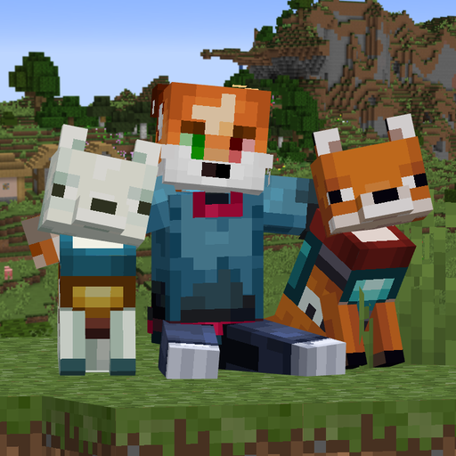

# FoxyFriends

Make foxes your friends  

English | [Русский](README.ru.md)

  
 

> The mod is in early development, features and balance may change between versions

## Features
- **Taming** - feed a fox raw chicken, rabbit or fish, a fox that already trusts you is tamed right away, a wild one has a 10% chance
- **Commands** - right-click your fox with an empty hand to give it a command: *Follow* (wow), *Sit* (dozes off when calm and sheltered) or *Wander* (roams around its home point, behavior mostly like vanilla)
- **Defense** - defends you from anyone who hurts you, joins your fights and strikes back when attacked
- **Care** - 25 hp and 3 attack dmg, anyone can heal it with meat, fish or berries, and it slowly regenerates when left alone
- **Petting** - sneak and right-click any fox with an empty hand, your own fox calms down and stays out of fights for a few seconds
- **Drop it** - sneak and right-click your fox with an empty hand to take whatever it holds in its mouth
- **Health** - look at your fox to see its health above the hotbar
- **Breeding** - a baby of two tamed foxes is born tamed to whoever fed the first parent, with one tamed parent it's a coin flip
- **Collar** - use any dye on your fox to recolor its collar
- **Armor** - leather, copper, iron, golden, diamond or netherite, right-click an adult fox with it to put it on, shears to take it off

More details in the [wiki](https://senzi.dev/foxyfriends/wiki/en)

Armor recipe

|&nbsp;|&nbsp;|&nbsp;|
|-|-|-|
|`M`|`M`|·|
|·|`M`|`L`|
|`M`|·|`M`|

`M` - leather, copper ingot, iron ingot, gold ingot or diamond  
`L` - leather

Netherite armor is upgraded from diamond at a smithing table  
Leather armor can be dyed and washed in a cauldron, it also keeps a fox warm in powder snow

Data pack tags

| tag | purpose |
|-|-|
| `#foxyfriends:fox_taming_food` | items that tame foxes |
| `#foxyfriends:fox_healing_food` | items that heal tamed foxes |
| `#foxyfriends:fox_wont_attack` | entities tamed foxes never attack |

Config

`config/foxyfriends.json` on the server - Wander hunting, wild taming chance, tamed fox health, damage and regeneration, `/foxyfriends reload`  
`config/foxyfriends-client.json` on the client - fox health above the hotbar  
With [Mod Menu](https://modrinth.com/mod/modmenu) and [YACL](https://modrinth.com/mod/yacl) both can be edited in game

## Requirements

| minecraft | fabric loader | fabric api | java |
|-|-|-|-|
| 26.3      | 0.20.1+       | 0.165.0+   | 25+  |

The mod and [Fabric API](https://modrinth.com/mod/fabric-api) are needed on both server and client sides  
[Mod Menu](https://modrinth.com/mod/modmenu) and [YACL](https://modrinth.com/mod/yacl) are optional, client only, for the config screen  
Build with `./gradlew build`, jar in `build/libs/`

## Feedback
For bugs, ideas or any other questions, [open an issue](https://github.com/senzifox/foxyfriends/issues) or [dm me](https://senzi.dev)

## Credits
Thanks to Vortianski for [Foxes & Stuff](https://github.com/Vortianski/Foxes---Stuff), the mod that sparked this  
Copyright (c) 2026 senzifox, [GPL-3.0](LICENSE)
